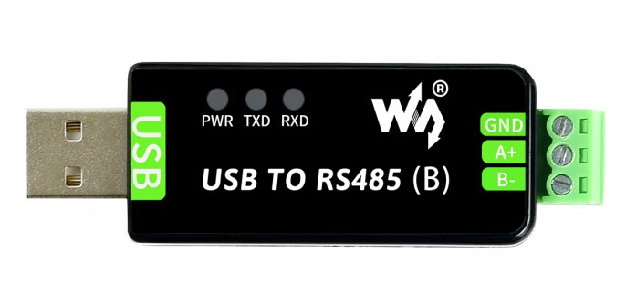
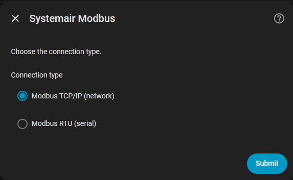
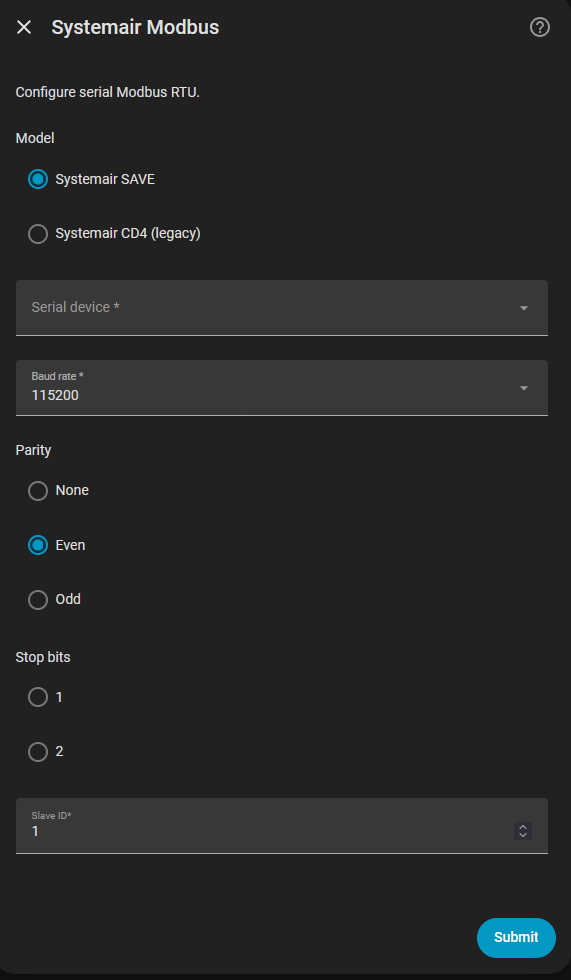
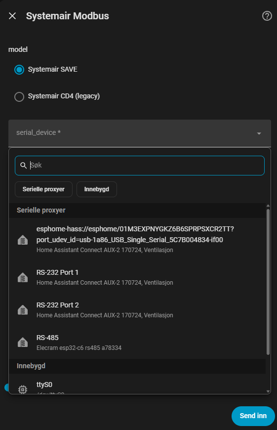

# Modbus RTU – connection guide

**Systemair Modbus for Home Assistant · SAVE and CD4**

[← Back to README](../README.md) · [Norsk veiledning](modbus-rtu.no.md) · [TCP/IP guide](modbus-tcp.md)

This guide explains how to connect a Systemair ventilation unit to Home Assistant using **Modbus RTU**, through an ESPHome serial proxy. With **Home Assistant Connect AUX-2**, an external USB-to-RS485 adapter connects to the AUX-2 USB port because AUX-2 has no direct RS485 A/B terminals. **Home Assistant Connect AUX-2** is the example used during development and physical testing. Other ESPHome-based RS485 devices may work if they expose a compatible serial device in Home Assistant; an ESP32-C6 has also been physically tested on SAVE VTR 500.

> **Safety:** Disconnect power to the ventilation unit before opening it or changing wiring. Verify terminal labels, electrical levels, and power requirements in the documentation for your exact unit and adapter. Consult a qualified professional if unsure.

## 1. How the RTU connection works

```text
Home Assistant → ESPHome → Connect AUX-2 → USB-to-RS485 adapter → Systemair SAVE / CD4
Home Assistant → ESPHome → another compatible RS485 device → Systemair SAVE / CD4
```

With RTU, the integration selects a **serial device** in Home Assistant instead of an IP address and TCP port. Modbus registers are read and written through this serial connection.

> **Do not confuse the connection types:** An Elfin EW11 exposing a Modbus TCP endpoint must be configured using the [TCP/IP guide](modbus-tcp.md), even if it uses RS485 towards the unit.

## 2. Requirements

- A Systemair SAVE or CD4 unit with an accessible Modbus interface.
- **Home Assistant Connect AUX-2 with a USB-to-RS485 adapter plugged into its USB port**, or another compatible ESPHome-based RS485 device.
- The device is available in Home Assistant and its serial proxy is exposed.
- **Systemair Modbus** installed through HACS.
- Correct serial Modbus settings and slave ID for the unit.

**SAVE and CD4 use different register maps.** Select the controller type rather than relying solely on the ventilation unit's model name.

## Choosing RTU hardware

### Option A – Home Assistant Connect AUX-2 with USB-to-RS485 adapter (tested setup)

**AUX-2 has no built-in RS485 A/B terminals.** Connect an external USB-to-RS485 adapter to **the USB port on AUX-2**. Connect the adapter's screw terminals to the ventilation unit's Modbus RS485 terminals. AUX-2 exposes the USB serial device to Home Assistant using an ESPHome serial proxy.



The pictured adapter has **GND**, **A+** and **B-** terminals. Verify terminal labels on both devices; A/B conventions can vary. **Do not connect GND based on assumptions**, and do not use the adapter's RS485 terminals for power. Follow the documentation for your unit and adapter.

This is the connection method tested with **Systemair SAVE VTR 500**. In this AUX-2 guide, the USB adapter is **not plugged into the Home Assistant host**.

### Option B – another ESPHome-based RS485 device

Another compatible ESPHome device with an RS485 interface may be used if it exposes the correct serial proxy. An ESP32-C6 with RS485 and an ESPHome serial proxy has also been physically tested on SAVE VTR 500. Other setups are not automatically verified.

## 3. Physical RS485 connection

1. Disconnect power before opening the ventilation unit.
2. Find the Modbus RS485 terminals in the documentation for your specific model.
3. Plug the USB-to-RS485 adapter into **the AUX-2 USB port**.
4. Connect the adapter's **A+ / B-** to the unit's RS485 A/B according to verified terminal labels. Connect GND only if required by the manufacturer's instructions.
5. Verify AUX-2 power, power up the equipment and confirm that the attached USB serial device is exposed through ESPHome in Home Assistant.

> **Important:** AUX-2 may expose several ports. Select **the USB serial proxy corresponding to the USB-to-RS485 adapter**. Do not choose **RS-232 Port 1** or **RS-232 Port 2** just because they appear in the list. The device must also expose a working ESPHome serial proxy; being visible in Home Assistant is not enough.

This guide does not provide a new universal wiring diagram. Follow the manufacturer's documentation for your exact unit and adapter; a SAVE VTR 500 diagram may not apply to CD4 or other models.

## 4. Add Systemair Modbus in Home Assistant

### Step 1 – Select Modbus RTU

Go to **Settings → Devices & services → Add integration**, find **Systemair Modbus**, and choose **Modbus RTU (serial)**.



Click **Submit** to open the RTU settings.

### Step 2 – Choose the controller and serial settings



| Field | Description |
|---|---|
| **Model** | Select **Systemair SAVE** or **Systemair CD4 (legacy)** according to the controller installed. |
| **Serial device** | The **AUX-2 USB serial proxy** for the connected USB-to-RS485 adapter, or an equivalent ESPHome proxy. |
| **Baud rate** | Must match the unit's Modbus settings. The screenshot shows `115200`, which is **not** a universal recommendation. |
| **Parity** | **None**, **Even**, or **Odd** according to the unit settings. **Even** is selected in the screenshot. |
| **Stop bits** | **1** or **2** according to the unit settings. Neither option is selected in the screenshot. |
| **Slave ID** | The unit's Modbus address; use its actual configured value. Allowed range: 1–247, default 1. |

**Do not blindly copy the screenshot values.** Baud rate, parity, stop bits and slave ID must match the physical Modbus connection.

### Step 3 – Select the correct serial device

Open the **Serial device** dropdown:



The older device-selection screenshot (Norwegian interface) shows a **Home Assistant Connect AUX-2** exposing several serial choices and a separate **RS-485** device from another ESPHome setup. These are **different devices/ports**, not interchangeable labels for the same port.

Select **the serial proxy corresponding to the RS485 interface actually wired to the Systemair unit**. For AUX-2, select the USB serial proxy corresponding to the attached USB-to-RS485 adapter, **not** the RS-232 ports or a local/built-in Home Assistant serial port. The separate RS-485 entry belongs to another setup and should only be selected if it is the physically connected adapter.

Complete the setup by clicking **Submit**.

## 5. Polling interval and communication

RTU uses a single serial connection. The integration serializes register operations to avoid concurrent requests. If a block read fails, it can retry individual registers to preserve as much sensor data as possible.

- A **30-second polling interval** is a sensible starting point based on the tested setup.
- The RTU implementation enforces a **minimum interval of 10 seconds**. Shorter intervals are not recommended.
- If timeouts or unstable values occur, investigate the connection before increasing the interval if needed.
- Avoid having independent Modbus clients send simultaneous requests on the same RS485 bus without a deliberate coordination design.

## 6. Verify the connection

1. Open the new Systemair device under **Devices & services**.
2. Confirm that temperatures and other readable values update.
3. Check diagnostics for **cycle duration**, **registers with values**, and **failed registers**, where available.
4. Verify that the correct unit/controller type is shown.
5. Only after stable reads: optionally test a **safe, reversible** setting and verify the result both in Home Assistant and on the unit's own panel.

The physically tested AUX-2 connection to a **SAVE VTR 500** worked for both reads and writes. This does not verify every combination of adapter, SAVE/CD4 controller and unit model.

## 7. Troubleshooting

### No serial device appears

- Confirm that the ESPHome device is available in Home Assistant.
- Confirm that its firmware and configuration actually expose a **serial proxy**.
- Make sure you are looking at the correct device rather than unrelated RS-232 or RS485 ports.

### The integration connects but no registers have values

- Verify that you selected the **physically connected RS485 port**.
- Check A/B wiring against the manufacturer's terminal labels.
- Verify **baud rate, parity, stop bits and slave ID**.
- Confirm the correct controller choice: SAVE or CD4.
- Inspect Home Assistant logs for communication errors or timeouts.

### Some values are missing or reads are unstable

- Check failed-register and cycle-duration diagnostics.
- Consider a longer polling interval if communication is overloaded.
- Investigate other Modbus clients on the same bus.
- Some registers and features may be unavailable on particular models or firmware versions.

## 8. Limitations and safety

RTU support is implemented for both SAVE and CD4, but **implemented support does not imply physical verification**. Available features depend on the unit model, firmware and adapter. CD4 support remains experimental.

Home Assistant does not replace the ventilation unit's built-in safety functions. Verify fan and temperature changes on the unit itself.

---

[← README](../README.md) · [TCP/IP guide](modbus-tcp.md) · [Norsk veiledning](modbus-rtu.no.md)
