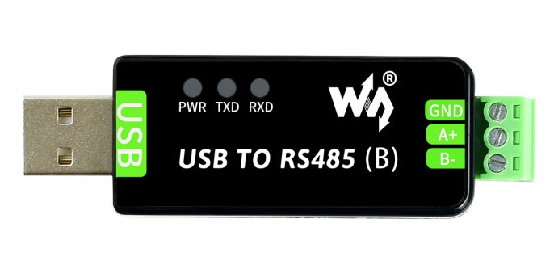
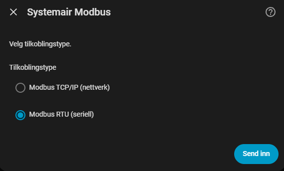
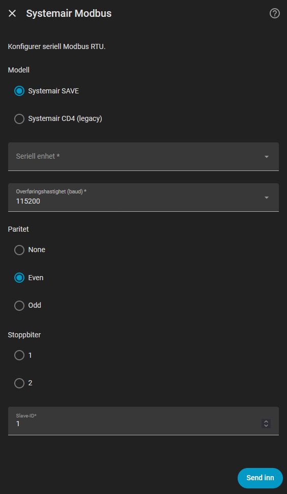
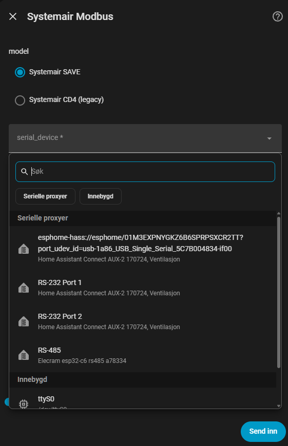

# Modbus RTU – tilkoblingsveiledning

**Systemair Modbus for Home Assistant · SAVE og CD4**

[← Tilbake til norsk README](../README.no.md) · [English guide](modbus-rtu.md) · [TCP/IP-veiledning](modbus-tcp.no.md)

Denne veiledningen beskriver hvordan du kobler et Systemair-aggregat til Home Assistant via **Modbus RTU**, gjennom en ESPHome seriell proxy. For **Home Assistant Connect AUX-2** kobles en ekstern USB–RS485-adapter til AUX-2 sin USB-port, siden AUX-2 ikke har egne A/B-terminaler. **Home Assistant Connect AUX-2** er eksemplet som er brukt i utvikling og fysisk testing. Andre ESPHome-baserte RS485-enheter kan fungere dersom de eksponerer en kompatibel seriell enhet i Home Assistant; ESP32-C6 er også fysisk testet på SAVE VTR 500.

> **Sikkerhet:** Koble fra strømmen til aggregatet før du åpner det eller endrer ledningskoblinger. Kontroller terminalmerking, elektriske nivåer og strømforsyning mot dokumentasjonen for akkurat ditt aggregat og adapter. Ved usikkerhet, bruk kvalifisert fagperson.

## 1. Hvordan fungerer RTU-tilkoblingen?

```text
Home Assistant → ESPHome → Connect AUX-2 → USB–RS485-adapter → Systemair SAVE / CD4
Home Assistant → ESPHome → annen kompatibel RS485-enhet → Systemair SAVE / CD4
```

Med RTU velger integrasjonen en **seriell enhet** i Home Assistant, i stedet for en IP-adresse og TCP-port. Den kan vises som en seriell proxy eller som en innebygd/lokal serieport, avhengig av installasjonen. Modbus-registrene leses og skrives gjennom den serielle forbindelsen.

> **Ikke bland tilkoblingstypene:** Elfin EW11 som eksponerer et Modbus TCP-endepunkt skal settes opp med [TCP/IP-guiden](modbus-tcp.no.md), selv om EW11 bruker RS485 mot aggregatet.

## 2. Forutsetninger

- Et Systemair SAVE- eller CD4-aggregat med tilgjengelig Modbus-grensesnitt.
- **Home Assistant Connect AUX-2 med en USB–RS485-adapter tilkoblet AUX-2 sin USB-port**, eller en annen kompatibel ESPHome-basert RS485-enhet.
- ESPHome-enheten må være lagt til i Home Assistant og eksponere den aktuelle serieporten via seriell proxy.
- **Systemair Modbus** er installert via HACS.
- Korrekte Modbus-serieparametere og slave-ID for aggregatet.

**SAVE og CD4 har ulike registerkart.** Valget i integrasjonen gjelder kontrollertypen, ikke bare modellnavnet på ventilasjonsaggregatet.

## Valg av RTU-utstyr

### Alternativ A – Home Assistant Connect AUX-2 med USB–RS485-adapter (testet oppsett)

**AUX-2 har ikke egne RS485 A/B-terminaler.** Derfor kobles en ekstern USB–RS485-adapter til **USB-porten på AUX-2**. Adapterens skruterminaler kobles videre til aggregatets Modbus RS485-terminaler. AUX-2 gjør USB-serieporten tilgjengelig i Home Assistant via ESPHome seriell proxy.



Adapteren på bildet har terminalene **GND**, **A+** og **B-**. Kontroller terminalmerking på begge sider; A/B-betegnelser kan variere mellom produsenter. **GND skal ikke kobles ut fra antakelser**, og adapterens RS485-terminaler må ikke brukes til strømforsyning. Følg dokumentasjonen for aggregat og adapter.

Dette er oppsettet som er testet med **Systemair SAVE VTR 500**. USB-adapteren skal **ikke** kobles til Home Assistant-maskinen i denne AUX-2-veiledningen.

### Alternativ B – annen ESPHome-basert RS485-enhet

En annen kompatibel ESPHome-enhet med RS485-grensesnitt kan også brukes dersom den eksponerer riktig seriell proxy. ESP32-C6 med RS485 og ESPHome seriell proxy er også fysisk testet på SAVE VTR 500. Andre oppsett er ikke automatisk verifisert.

## 3. Fysisk RS485-tilkobling

1. Slå av strømmen til aggregatet før du åpner det.
2. Finn aggregatets Modbus RS485-terminaler i dokumentasjonen for din modell.
3. Koble USB–RS485-adapteren til **USB-porten på AUX-2**.
4. Koble adapterens **A+ / B-** til aggregatets RS485 A/B etter korrekt terminalmerking. Vurder GND bare etter produsentens anvisninger.
5. Kontroller AUX-2 sin strømforsyning og start utstyret. Kontroller at den tilkoblede USB-serieporten eksponeres via ESPHome i Home Assistant.

> **Viktig:** AUX-2 kan eksponere flere porter. Velg **USB-serieproxyen som tilhører USB–RS485-adapteren**. Ikke velg **RS-232 Port 1** eller **RS-232 Port 2** bare fordi de vises i listen. Kontroller også at riktig firmware/ESPHome-oppsett tilbyr seriell proxy; det er ikke tilstrekkelig at enheten bare er synlig i Home Assistant.

Det finnes ikke et nytt fysisk koblingsskjema i denne guiden. Bruk produsentens dokumentasjon for ditt konkrete aggregat og adapter; et SAVE VTR 500-skjema er ikke nødvendigvis gyldig for CD4 eller andre modeller.

## 4. Legg til Systemair Modbus i Home Assistant

### Steg 1 – Velg Modbus RTU

Gå til **Innstillinger → Enheter og tjenester → Legg til integrasjon**, finn **Systemair Modbus**, og velg **Modbus RTU (seriell)**.



Trykk **Send inn** for å åpne RTU-konfigurasjonen.

### Steg 2 – Velg kontrollertype og serieinnstillinger



| Felt | Hva du velger |
|---|---|
| **Modell** | **Systemair SAVE** eller **Systemair CD4 (legacy)**, etter hvilken kontroller aggregatet har. |
| **Seriell enhet** | AUX-2 sin **USB-serieproxy** for den tilkoblede USB–RS485-adapteren, eller tilsvarende proxy på en annen ESPHome-enhet. |
| **Overføringshastighet (baud)** | Må samsvare med aggregatets Modbus-konfigurasjon. Skjermbildet viser `115200`, men dette er **ikke** en universell anbefaling. |
| **Paritet** | **None**, **Even** eller **Odd**, etter aggregatets innstillinger. Skjermbildet viser **Even** som valgt eksempel. |
| **Stoppbiter** | **1** eller **2**, etter aggregatets innstillinger. Ingen av alternativene er markert i skjermbildet. |
| **Slave-ID** | Modbus-adressen til aggregatet. Bruk den faktiske verdien fra aggregatets oppsett. Tillatt område: 1–247, standard 1. |

**Ikke kopier verdier ukritisk fra bildet.** Baudrate, paritet, stoppbiter og slave-ID må stemme med den fysiske Modbus-forbindelsen.

### Steg 3 – Velg riktig seriell enhet

Åpne listen under **Seriell enhet**:



I eksemplet vises en **Home Assistant Connect AUX-2** med flere serielle valg, samt en separat **RS-485**-enhet fra et annet ESPHome-oppsett. Dette er **forskjellige enheter/porter**, ikke alternative navn for samme port.

Velg **USB-serieproxyen som tilhører adapteren koblet til AUX-2** under **Serielle proxyer**. Ikke velg **Innebygd** for dette oppsettet, og ikke velg AUX-2 sine RS-232-porter. Den separate RS-485-enheten i listen tilhører et annet oppsett og skal bare velges dersom den er den fysisk tilkoblede adapteren.

Fullfør oppsettet med **Send inn**.

## 5. Oppdateringsintervall og kommunikasjon

RTU-kommunikasjonen går over én seriell forbindelse, og integrasjonen koordinerer registeroperasjonene for å unngå samtidige forespørsler. Ved feil på en blokklesing kan integrasjonen forsøke enkeltregistre for å beholde mest mulig sensordata.

- Et **oppdateringsintervall på 30 sekunder** er et fornuftig utgangspunkt fra testoppsettet.
- RTU-implementasjonen har et **minsteintervall på 10 sekunder**. Kortere intervaller anbefales ikke.
- Hvis du opplever timeout eller ustabile verdier, undersøk kommunikasjonen før du eventuelt øker intervallet.
- Unngå at flere uavhengige Modbus-klienter sender forespørsler samtidig på samme RS485-buss uten en bevisst løsning for dette.

## 6. Slik kontrollerer du at det fungerer

1. Åpne den nye Systemair-enheten under **Enheter og tjenester**.
2. Kontroller at temperaturer og andre lesbare verdier blir oppdatert.
3. Se etter diagnostikk for **gjennomgangstid**, **registre med verdier** og **feilede registre**, der disse er tilgjengelige.
4. Kontroller at registrert aggregat-/kontrollertype er riktig.
5. Først når lesing er stabil: prøv eventuelt en **ufarlig, reverserbar** innstilling og kontroller resultatet både i Home Assistant og på aggregatets panel.

Den fysisk testede AUX-2-forbindelsen mot **SAVE VTR 500** har fungert med både lesing og skriving. Dette dokumenterer ikke automatisk alle kombinasjoner av adapter, SAVE/CD4 og aggregatmodell.

## 7. Feilsøking

### Ingen seriell enhet i listen

- Kontroller at ESPHome-enheten er tilgjengelig i Home Assistant.
- Kontroller at firmware og konfigurasjon faktisk eksponerer en **seriell proxy**.
- Kontroller at du ser riktig enhet, og ikke bare andre RS-232- eller RS485-porter.

### Integrasjonen kobler til, men får ingen registerverdier

- Kontroller at du valgte den **fysisk tilkoblede RS485-porten**.
- Kontroller A/B-ledningene mot produsentens terminalmerking.
- Kontroller **baudrate, parity, stopbits og slave-ID**.
- Kontroller at du valgte riktig kontroller: SAVE eller CD4.
- Se etter feilmeldinger eller timeouts i Home Assistant-loggen.

### Noen verdier mangler, eller lesing er ustabil

- Kontroller diagnostikken for feilede registre og gjennomgangstid.
- Vurder lengre oppdateringsintervall dersom kommunikasjonen er belastet.
- Undersøk eventuelle andre Modbus-klienter på samme buss.
- Merk at enkelte registre og funksjoner kan være utilgjengelige på enkelte modeller eller firmwareversjoner.

## 8. Begrensninger og sikkerhet

RTU-støtten er implementert for både SAVE og CD4, men **fysisk verifisering er ikke det samme som implementert støtte**. Funksjoner kan variere med aggregatmodell, firmware og adapter. CD4-støtten er fortsatt eksperimentell.

Ikke bruk Home Assistant som erstatning for aggregatets egne sikkerhetsfunksjoner. Endringer i viftedrift og temperatur skal verifiseres på aggregatet.

---

[← Norsk README](../README.no.md) · [TCP/IP-veiledning](modbus-tcp.no.md) · [English version](modbus-rtu.md)
