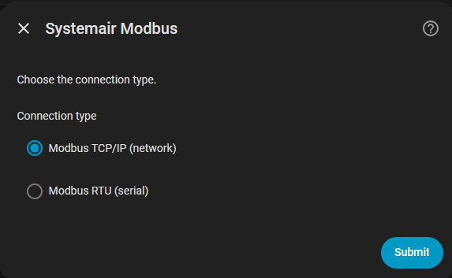
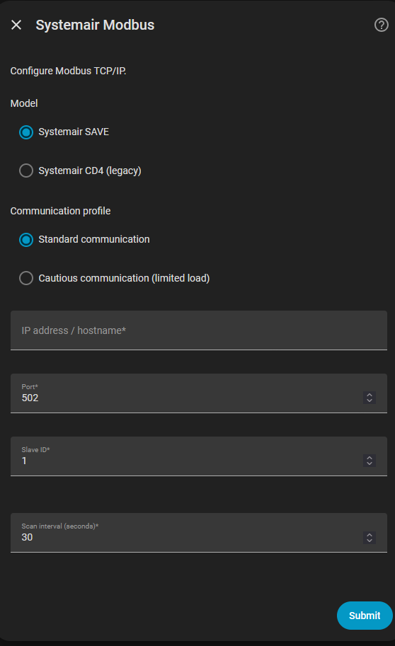

# Modbus TCP/IP – connection guide

**Systemair Modbus for Home Assistant · SAVE and CD4**

[← Back to README](../README.md) · [Norsk veiledning](modbus-tcp.no.md)

This guide explains how to connect a Systemair ventilation unit to Home Assistant using **Modbus TCP/IP**. It covers an external RS485-to-TCP gateway such as the **Elfin EW11**, as well as relevant settings for **Systemair SAVE Connect**.

> **Safety:** This is an unofficial community project. Disconnect power before opening the ventilation unit. If you are unsure about electrical wiring, consult a qualified professional. Verify terminals and electrical ratings against the documentation for your particular unit and gateway.

## 1. Connection overview

```text
Home Assistant ── network / Modbus TCP ── gateway ── RS485 / Modbus RTU ── Systemair
```

A TCP gateway allows Home Assistant to communicate with the unit's serial Modbus interface over the network. If you already have a working Modbus TCP endpoint, skip to [Home Assistant setup](#5-add-the-integration-in-home-assistant).

This is the **TCP/IP connection method from Home Assistant**, even though the gateway may communicate with the ventilation unit over Modbus RTU.

## 2. Requirements

- A Systemair SAVE or CD4 unit with Modbus communication available.
- A Modbus TCP endpoint, such as an Elfin EW11 or compatible gateway.
- Home Assistant with **Systemair Modbus** installed via HACS.
- Network connectivity between Home Assistant and the gateway.
- Correct Modbus slave ID and serial settings for the ventilation unit.

> **Note:** SAVE and CD4 use different Modbus register maps. Select the correct unit/controller type during setup. Available features vary by model and configuration.

## 3. Physical connection – Elfin EW11 example

### 3.1 Locate the Modbus terminals

The SAVE example in the original guide uses communication terminals labelled `A (+)` and `B (–)`, with separate `24V` and `GND` terminals.


Always check the terminals for **your** model. Do not assume CD4 and SAVE have identical terminal layouts.

### 3.2 Connect the EW11

Use the diagram as a reference, but confirm the power supply, polarity and RS485 markings against your particular gateway's documentation.


Do not apply power until the gateway's supply voltage has been verified.

## 4. Configure the Elfin EW11

These steps are adapted from the project's existing EW11 guide. Menu names and factory defaults may vary by firmware version.

1. Connect to the EW11 Wi-Fi network, typically `EW1x_...` during initial setup.
2. Open the gateway web interface. The documented default address is `http://10.10.100.254`.
3. Sign in. The original guide lists `admin` / `admin` as factory credentials. **Change the default password if it is still active.**
4. Open **System Settings → WiFi Settings**, choose `STA`, and connect the gateway to your local network.
5. Restart the gateway and assign a static or DHCP-reserved IP address.
6. Open **Serial Port Settings**. Match the baud rate, parity, data bits and stop bits to the unit's Modbus configuration.


7. Open **Communication Settings** and configure Modbus TCP communication as illustrated in the original guide.


8. Check the **Status** page once Home Assistant starts polling registers.


> **Do not blindly copy serial parameters from screenshots.** Use the values required by your unit. The TCP port is commonly `502`, but must match your gateway configuration.

## 5. Add the integration in Home Assistant

Once your gateway is configured and reachable on the network, add Systemair Modbus in Home Assistant.

### 5.1 Select the connection type

1. Install **Systemair Modbus** through HACS if it is not already installed.
2. Restart Home Assistant if required.
3. Open **Settings → Devices & Services → Add integration**.
4. Search for and select **Systemair Modbus**.
5. Choose **Modbus TCP/IP (network)** and select **Submit**.



> Choose **Modbus TCP/IP** even when an EW11 communicates with the ventilation unit over RS485. The **Modbus RTU (serial)** option is for direct serial communication through ESPHome, not a TCP gateway.

### 5.2 Enter the connection settings

The next screen contains the Modbus TCP/IP configuration fields:



| Field | Description |
|---|---|
| **Model** | Select **Systemair SAVE** or **Systemair CD4 (legacy)** according to the controller in your unit. |
| **Communication profile** | Use **Standard communication** for typical TCP gateways such as EW11. Choose **Cautious communication (limited load)** when a gentler profile is needed, for example with SAVE Connect. |
| **IP address / hostname** | The IP address or hostname of your Modbus TCP gateway. |
| **Port** | The TCP port configured on the gateway, commonly `502`. |
| **Slave ID** | The unit's Modbus slave ID, often `1`; verify the actual setting. Allowed range: 1–247, default 1. |
| **Scan interval (seconds)** | Polling interval in seconds. The screenshot shows the default value `30`. |

The screenshot shows the English interface.

Select **Submit** to finish. Check that the integration creates the device, sensor values update, and the correct unit model appears in device information when model identification is available.

**Important:** Confirm basic register reads before testing writable controls. Verify any changes on the ventilation unit's own control panel.

## 6. Gateway profiles and polling interval

Gateways have different capabilities. The integration therefore provides a **Communication profile** setting:

| Profile | Intended use |
|---|---|
| **Standard communication** | Default for external gateways such as EW11; can use larger read batches. |
| **Cautious communication (limited load)** | More conservative reads with smaller batches and adjustments for SAVE Connect limitations. |

You can change the gateway profile under the integration's **Options** without reinstalling it.

A polling interval of around **30 seconds** is a sensible starting point. For unstable SAVE Connect installations, **30–60 seconds** may be preferable. Avoid unnecessarily aggressive polling.

## 7. Verify communication

When Home Assistant polls registers, relevant sensors should populate and the EW11 packet counters should normally increase.

**Zero packet counts before the integration starts are not necessarily an error.** Modbus RTU is a request/response protocol: the ventilation unit does not normally send register values on its own.

If the counters remain at zero after the integration attempts to communicate, check RS485 A/B, serial parameters, slave ID and gateway settings.

## 8. Troubleshooting

### “Failed to connect”

- Verify the gateway IP address and network reachability from Home Assistant.
- Check the TCP port (commonly `502`) and any VLAN/firewall restrictions.
- Make sure the endpoint actually serves **Modbus TCP**, not just a web interface.
- Check whether the gateway limits simultaneous client connections.

### TCP connects but sensors do not populate

- Check RS485 A/B and the unit's Modbus slave ID.
- Verify baud rate, parity and stop bits.
- Confirm the selected controller type is SAVE or CD4 as appropriate.
- Look for increasing gateway packet counters during polling.

### Intermittent read errors or instability

- Try **Cautious communication (limited load)** when using SAVE Connect.
- Increase the polling interval, for example to 30–60 seconds.
- Check whether multiple Modbus clients are competing for the same gateway or RS485 bus.
- Avoid changing several variables at once while troubleshooting.

## 9. Related documentation

- [Main README](../README.md)
- Use the repository's **Issues** tab for reports and feedback.

## Acknowledgement

The original Elfin EW11 guide in this project's README is based on work published at [domotics.no](https://www.domotics.no/) by **Mads Nedrehagen**. Existing diagrams and screenshots are preserved with updated relative image paths.
