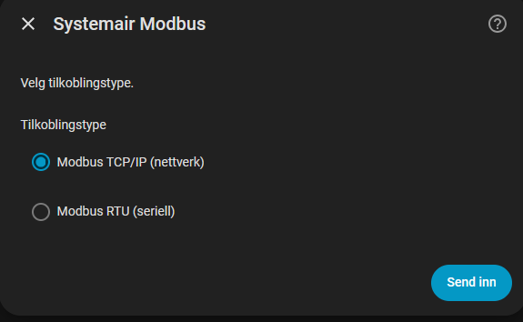
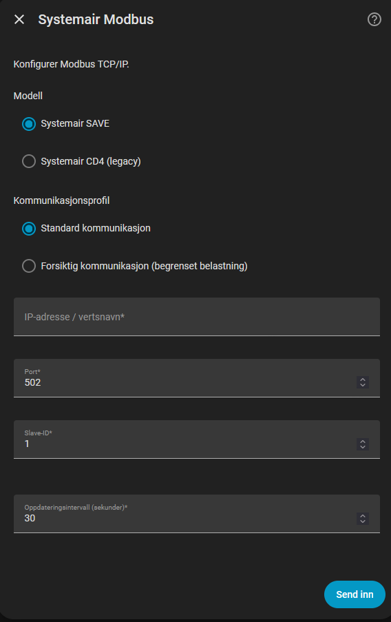

# Modbus TCP/IP – tilkoblingsveiledning

**Systemair Modbus for Home Assistant · SAVE og CD4**

[← Tilbake til norsk README](../README.no.md) · [English guide](modbus-tcp.md)

Denne veiledningen beskriver tilkobling av et Systemair-aggregat til Home Assistant over **Modbus TCP/IP**. Den dekker både en ekstern RS485-til-TCP-gateway, som **Elfin EW11**, og relevante innstillinger for **Systemair SAVE Connect**.

> **Viktig:** Dette er et uoffisielt community-prosjekt. Koble fra strømmen til aggregatet før det åpnes. Ved usikkerhet om elektrisk tilkobling, bruk kvalifisert fagperson. Klemmenavn og elektriske spesifikasjoner må kontrolleres mot dokumentasjonen for ditt aggregat og din gateway.

## 1. Slik fungerer tilkoblingen

```text
Home Assistant ── nettverk / Modbus TCP ── gateway ── RS485 / Modbus RTU ── Systemair
```

En TCP-gateway gjør det mulig for Home Assistant å kommunisere med aggregatets serielle Modbus-grensesnitt over nettverket. Dersom du allerede har et fungerende Modbus TCP-endepunkt, kan du gå direkte til [oppsett i Home Assistant](#5-legg-til-integrasjonen-i-home-assistant).

Denne guiden gjelder **TCP/IP-forbindelsen til Home Assistant**, selv om forbindelsen mellom gatewayen og aggregatet er Modbus RTU.

## 2. Utstyr og forutsetninger

- Systemair SAVE- eller CD4-aggregat med tilgjengelig Modbus-kommunikasjon.
- Et Modbus TCP-endepunkt, for eksempel Elfin EW11 eller en kompatibel gateway.
- Home Assistant med **Systemair Modbus** installert via HACS.
- Nettverkstilgang mellom Home Assistant og gatewayen.
- Korrekt Modbus slave-ID og serieparametere for aggregatet.

> **Merk:** SAVE og CD4 har ulike registerkart. Velg riktig aggregat-/kontrollertype under oppsettet. Tilgjengelige funksjoner varierer med modell og konfigurasjon.

## 3. Fysisk tilkobling – eksempel med Elfin EW11

### 3.1 Finn Modbus-tilkoblingen på aggregatet

På SAVE-eksempelet i den opprinnelige veiledningen er kommunikasjonsterminalene merket `A (+)` og `B (–)`, med separate terminaler for `24V` og `GND`.


Kontroller alltid terminalplasseringen på **din** modell. Ikke anta at CD4 og SAVE har identisk terminaloppsett.

### 3.2 Koble til EW11

Bruk koblingsskjemaet som utgangspunkt, men kontroller strømforsyning, polaritet og RS485-merking mot dokumentasjonen til den konkrete gatewayen.


Ikke koble strøm til gatewayen før forsyningsspenningen er bekreftet å være riktig.

## 4. Konfigurer Elfin EW11

Følgende trinn er hentet fra den eksisterende EW11-veiledningen. Menynavn og fabrikkinnstillinger kan variere mellom firmwareversjoner.

1. Koble til EW11 sitt Wi-Fi-nettverk, typisk `EW1x_...` ved førstegangsoppsett.
2. Åpne gatewayens webgrensesnitt. Den dokumenterte standardadressen er `http://10.10.100.254`.
3. Logg inn. Den eksisterende veiledningen oppgir `admin` / `admin` som fabrikkinnlogging. **Endre standardpassord dersom det fortsatt er aktivt.**
4. Gå til **System Settings → WiFi Settings**, velg `STA` og koble gatewayen til det lokale nettverket.
5. Start gatewayen på nytt og gi den en fast eller reservert IP-adresse.
6. Åpne **Serial Port Settings**. Sett baudrate, paritet, databiter og stoppbiter i samsvar med aggregatets Modbus-konfigurasjon.


7. Åpne **Communication Settings** og konfigurer gatewayen for Modbus TCP-kommunikasjon slik den eksisterende veiledningen viser.


8. Kontroller **Status**-siden når Home Assistant har begynt å lese registre.


> **Ikke kopier serieinnstillinger ukritisk fra skjermbildene.** Bruk verdiene som gjelder ditt aggregat. TCP-porten er ofte `502`, men må stemme med gatewayens konfigurasjon.

## 5. Legg til integrasjonen i Home Assistant

Når gatewayen er konfigurert og tilgjengelig på nettverket, kan du legge til Systemair Modbus i Home Assistant.

### 5.1 Velg tilkoblingstype

1. Installer **Systemair Modbus** via HACS hvis integrasjonen ikke allerede er installert.
2. Start Home Assistant på nytt hvis installasjonen krever det.
3. Gå til **Innstillinger → Enheter og tjenester → Legg til integrasjon**.
4. Søk etter og velg **Systemair Modbus**.
5. Velg **Modbus TCP/IP (nettverk)** og trykk **Send inn**.



> Velg **Modbus TCP/IP** også når du bruker en EW11 som kommuniserer med aggregatet over RS485. Alternativet **Modbus RTU (seriell)** gjelder direkte seriell kommunikasjon gjennom ESPHome, ikke en TCP-gateway.

### 5.2 Fyll inn tilkoblingsinnstillingene

Neste skjermbilde viser innstillingene for Modbus TCP/IP:



| Felt i skjermbildet | Hva du skal velge eller fylle inn |
|---|---|
| **Modell** | **Systemair SAVE** eller **Systemair CD4 (legacy)**, avhengig av kontrolleren i aggregatet. |
| **Kommunikasjonsprofil** | **Standard kommunikasjon** for vanlige TCP-gatewayer som EW11. **Forsiktig kommunikasjon (begrenset belastning)** ved behov for en mer skånsom profil, eksempelvis SAVE Connect. |
| **IP-adresse / vertsnavn** | IP-adressen eller vertsnavnet til Modbus TCP-gatewayen på nettverket ditt. |
| **Port** | TCP-porten gatewayen er konfigurert til å bruke, vanligvis `502`. |
| **Slave-ID** | Modbus slave-ID for aggregatet, ofte `1`. Kontroller faktisk verdi. Tillatt område: 1–247, standard 1. |
| **Oppdateringsintervall (sekunder)** | Antall sekunder mellom oppdateringer. Skjermbildet viser standardverdien `30`. |

Skjermbildet viser norsk oppsett.

Trykk **Send inn** for å fullføre oppsettet. Kontroller deretter at integrasjonen oppretter enheten, at sensorene får verdier, og at riktig aggregatmodell vises i enhetsinformasjonen når modellidentifikasjon er tilgjengelig.

**Viktig:** Kontroller grunnleggende lesing før du tester skrivebare funksjoner. Eventuelle endringer bør verifiseres på aggregatets eget betjeningspanel.

## 6. Gateway-profiler og oppdateringsintervall

Ulike gatewayer har ulike begrensninger. Integrasjonen har derfor en innstilling for **Kommunikasjonsprofil**:

| Profil | Bruksområde |
|---|---|
| **Standard kommunikasjon** | Standardprofil for eksterne gatewayer som EW11. Kan benytte større leseblokker. |
| **Forsiktig kommunikasjon (begrenset belastning)** | Mer forsiktig lesing, med mindre blokker og tilpasning til begrensninger ved SAVE Connect. |

Gateway-profilen kan endres under integrasjonens **Alternativer**, uten reinstallasjon.

Et oppdateringsintervall på rundt **30 sekunder** er et fornuftig utgangspunkt. Ved ustabilitet med SAVE Connect kan **30–60 sekunder** være aktuelt. Ikke øk belastningen unødvendig ved å bruke svært korte intervaller.

## 7. Kontroller kommunikasjonen

Når Home Assistant leser registre, skal relevante sensorer få verdier og EW11s pakketellere normalt begynne å øke.

**At pakketellerne står på null før integrasjonen er startet, er ikke nødvendigvis en feil.** Modbus RTU er en forespørsel/svar-protokoll: aggregatet sender normalt ikke registerdata på eget initiativ.

Hvis tellerne fortsatt er null etter at integrasjonen forsøker å kommunisere, kontroller RS485 A/B, serieparametere, slave-ID og gatewayinnstillinger.

## 8. Feilsøking

### «Failed to connect»

- Kontroller IP-adressen og at Home Assistant når gatewayen over nettverket.
- Kontroller TCP-porten (ofte `502`) og eventuelle VLAN-/brannmurregler.
- Kontroller at endepunktet faktisk tilbyr **Modbus TCP**, ikke bare et webgrensesnitt.
- Kontroller om gatewayen begrenser antall samtidige forbindelser.

### TCP-forbindelsen virker, men sensorer får ikke verdier

- Kontroller RS485 A/B og aggregatets Modbus slave-ID.
- Kontroller baudrate, paritet og stoppbiter.
- Kontroller at riktig kontrollertype, SAVE eller CD4, er valgt.
- Se etter økende pakketellere på gatewayen når integrasjonen forsøker å lese.

### Ustabilitet eller tilfeldige lesefeil

- Prøv **Forsiktig kommunikasjon (begrenset belastning)** hvis du bruker SAVE Connect.
- Øk oppdateringsintervallet, for eksempel til 30–60 sekunder.
- Undersøk om flere Modbus-klienter samtidig belaster samme gateway eller RS485-buss.
- Unngå å endre mange innstillinger samtidig under feilsøking.

## 9. Videre lesing

- [Hovedside – norsk](../README.no.md)
- Bruk repositoryets **Issues**-fane for tilbakemeldinger

## Kreditering

Den opprinnelige Elfin EW11-veiledningen i prosjektets README bygger på arbeid publisert på [domotics.no](https://www.domotics.no/) av **Mads Nedrehagen**. Koblingsskjemaene og skjermbildene fra eksisterende README er videreført med relative bildelenker.
